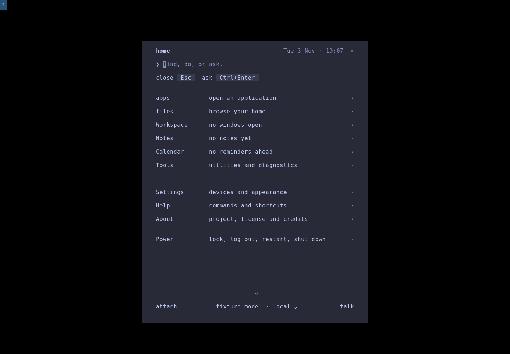
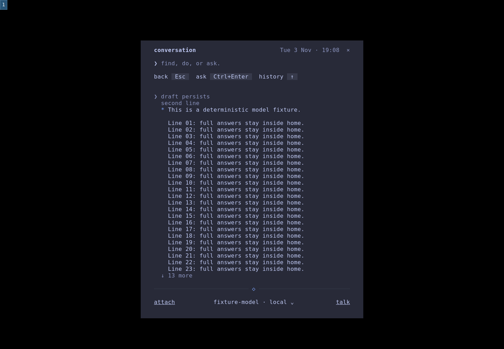

# Apps v0 native review

The owner approved the [revised wireframe](approved-wireframe.pdf). This report
records implementation-session visual and functional verification of that
implementation. Approval to merge remains separate; keep PR #213 open.

The branch includes main `6f8421e`, including the home root-menu merge and the
subsequent installer and bar work. The Apps changelog update is retained.

## Approved layout in the actual interface

| Surface | Compact | Fullscreen | Left snap | Right snap |
| --- | --- | --- | --- | --- |
| apps |  |  |  |  |
| details |  |  |  |  |

The primary captures use real Void desktop entries and XBPS metadata in native
Sway/foot, 1440x1000 at scale 1, monospace 12. Compact is 60x40 terminal cells;
minimum is 36x20. Both snaps occupy equal 720x972 work areas below the bar.
Model and voice readiness are deterministic fixtures, labelled in the footer.
Temporary preferences and test desktop entries leave the user's configuration
and system launchers intact.

1. **Browse and search.** The repeated body title and Category label are gone.
   The all categories filter and hidden apps toggle share the list's top row.
   Titles start at the shared left inset; a blank row and two-cell indent
   separate their children. Short supplied names and roles lead the list.
   Firefox uses its supplied Name; mpv media player and btop++ keep their
   supplied names. Full names, roles and original comments remain searchable.
2. **Hidden entries.** [Hidden helper entries](hidden-helpers.png) shows foot
   client and foot server explicitly labelled hidden; foot remains visible.
   The default list conceals hidden entries. The hide / unhide toggle has a
   bold, underlined current choice, independent of focus. Clicking the already
   selected choice leaves it selected. Revealing entries does not restore them.
   Details -> visibility -> unhide -> save stores an explicit user override.
3. **Details and edits.** Overview, technical details and preferences use the
   same heading, spacing, child inset and value column. Open application is
   above technical details. Save and cancel share a stable row with separate
   keyboard and pointer targets. Clean Details has no repeated apps prefix or
   permanent saved label. Original paths and identifiers keep their spelling.
4. **Labels, color and focus.** Apps labels and shared controls are lowercase;
   supplied metadata and physical key names keep their spelling. Headings are
   bold, controls and names use foreground, supporting roles use muted text.
   Accent text identifies focus; the shared diamond retains its accent. Toggles
   have a non-color state cue. Hovering a shortcut keeps the selected app, so
   clicking details still inspects it. Pointer movement cannot move its target
   by dropping a selection-driven scroll offset.
5. **Narrow and expanded states.** [Minimum list](apps-minimum.png),
   [long metadata](minimum-long-metadata.png),
   [copied launcher path](minimum-technical-attachment.png) and
   [preferences with attachment](minimum-preferences-attachment.png) keep all
   content reachable above the reserved footer. Labels and values stack;
   wrapped preference lines retain one logical target. Long tokens are wrapped
   rather than dropped. An incomplete header subtitle is omitted at small sizes.
6. **Save, cancel and dirty exit.** [Unsaved edits](contract/01-unsaved-preferences.png),
   [exit decision](contract/02-exit-decision.png),
   [category decision](contract/05-category-exit-decision.png) and
   [real permission failure](contract/06-save-failure.png) exercise explicit
   Save/Discard/Keep editing. Esc keeps edits in the decision. Failed saves keep
   the draft and previous stored preference. Category mappings also require save.
7. **Launch and recovery.** Actual foot and Terminal=true btop launches use GIO.
   Saved Focus existing follows the most recent reliable match or launches when
   none remains. A labelled desktop-entry fixture supplies New window.
   [Opened application](application-opened.png), [no matches](no-matches.png),
   [hidden search](hidden-search.png), [missing metadata](missing-metadata.png),
   [empty catalog](empty-catalog.png), [discovery failure](discovery-failure.png)
   and [launch failure](launch-failure.png) cover visible outcomes and recovery.
   Failure responses are explicit fixtures; an accepted request is not reported
   as a confirmed window.
8. **Shared home contracts.** Separate request and Apps drafts restore without
   mixing them. Ask is explicit; chat remains in home. The native comparison
   covers home/apps/files in compact, fullscreen and both snaps, with identical
   frame anchors and preserved state. [AI unavailable](contract/07-details-ai-unavailable.png)
   keeps native Details usable after restart. File-transfer integration remains
   part of the Files delivery.

| Quiet home, configured footer | Conversation, configured footer |
| --- | --- |
|  |  |

[The unavailable footer](home/root-unavailable-void.png) retains no model and a
quiet unavailable talk control. These captures use the production theme, with
foreground 8.80:1, muted 4.79:1 and accent 5.64:1 against the background; manifests
record the actual palette. These checks do not establish accessibility conformance.

## Validation

- 288 Rust tests, including 21 Apps regressions; formatting and Clippy passed.
- Nine native adapter tests passed on Void. On macOS three portable tests pass
  and six GIO tests explicitly skip. Coverage includes localized supplied names,
  full-name retention, short roles, inert inspection and native launch semantics.
- [Fourteen native Apps workflow checks](native.json) passed, including real launches, focus behavior, category edits, visibility and restart persistence.
- [Four shared-contract flow groups](contract/contract.json) passed.
- [Thirteen native home checks](home/native.json) passed, including configurable
  bindings, explicit Ask, single-process refocus and footer controls after resize.
- Two independent musl release builds match the pinned SHA-256:
  `69fc62b2bc297f960f1ed687e08bfa899999985eb268a20a8446b3c87e4d6ef6`.
- [Source hashes](source-sha256.json) match the native checkout and delivered tree.
- The local quick gate passed all 26 checks, including release PTY interaction, installer regressions, lint and Python suites.
- The local full shell suite has three host-dependent failures (workspace glyphs, login screen selection and session facts) also reproduced on unchanged main `6f8421e`; hosted container CI is checked separately.

The old Arch bar fixture fed all clicks before the initial frame and used a
fixed three-second delay. It now waits for the first frame, feeds clicks through
a FIFO, and waits for observed redraw and click results before shutdown. The
bar redraw and PID cleanup checks passed on Void. Hosted push CI and CodeQL
results for the exact submitted head are recorded in the PR body; same-repository
pull-request CI is intentionally skipped.

## Reproduce

```sh
cd dialog
cargo fmt --check
cargo clippy --locked --all-targets -- -D warnings
cargo test --locked
cd ..
python3 tests/apps_test.py
sh tests/gate.sh --quick
```

On Void with native Sway, foot, grim, wtype and wl-clipboard:

```sh
sh tests/dialog_build.sh
python3 tests/apps_desktop_proof.py \
  dialog/target/x86_64-unknown-linux-musl/release/spark-dialog /tmp/apps-proof
python3 tests/apps_contract_desktop_proof.py \
  dialog/target/x86_64-unknown-linux-musl/release/spark-dialog /tmp/apps-contract-proof
python3 tests/home_desktop_proof.py \
  dialog/target/x86_64-unknown-linux-musl/release/spark-dialog /tmp/home-proof
```

## Limits

Native interaction coverage is Void/Sway/Wayland. X11 class matching, DBus
activation, Flatpak permissions and other package managers were not exercised
interactively. No screen-reader conformance claim. This implementation-session
review is separate from the owner's final visual and functional approval.
