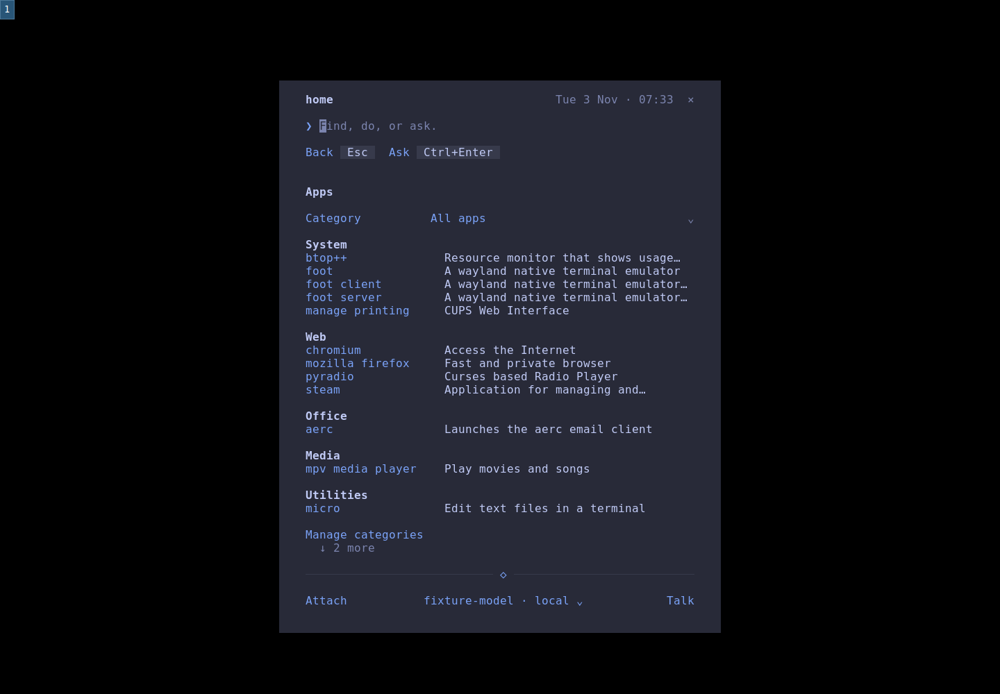
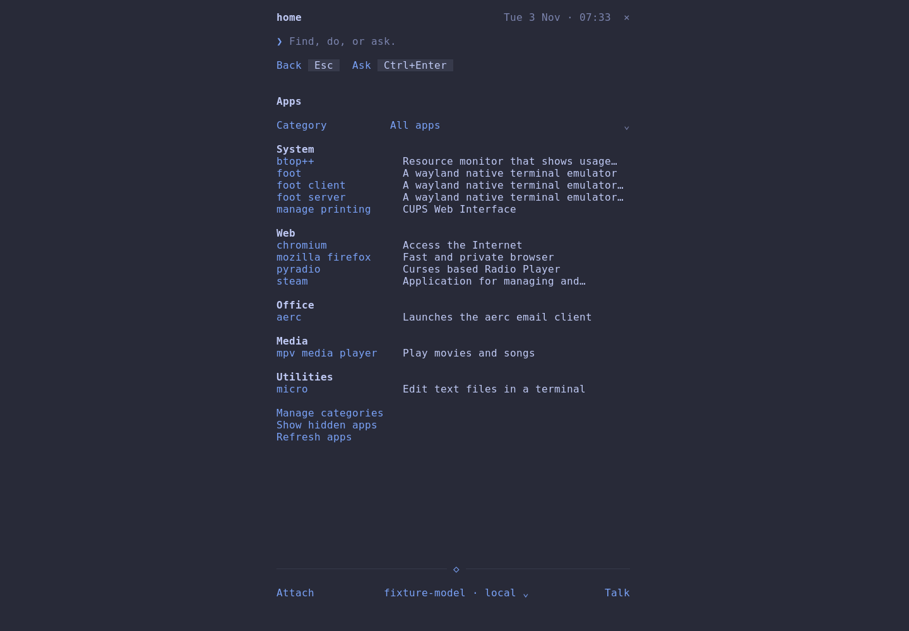
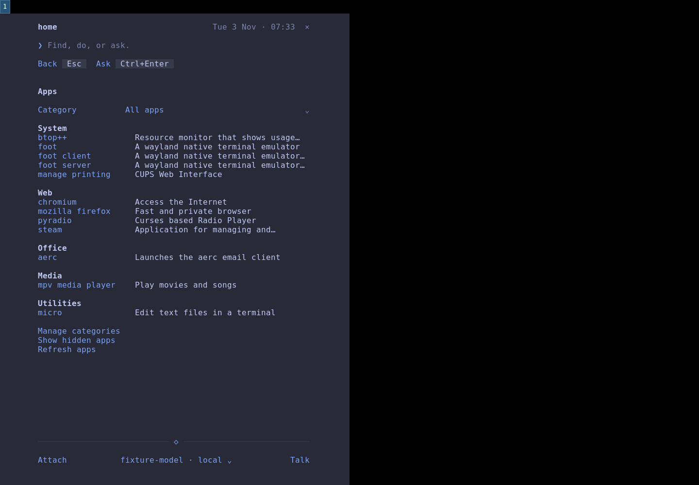
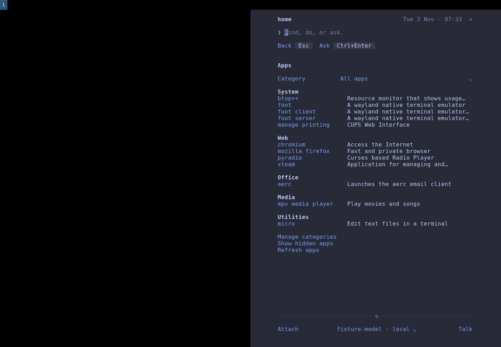
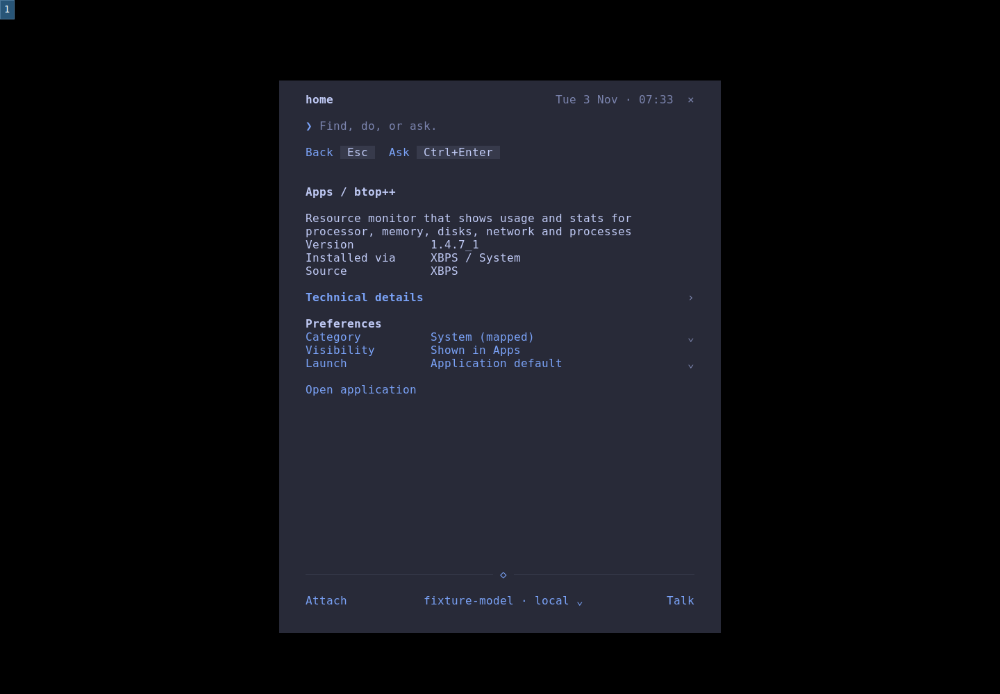
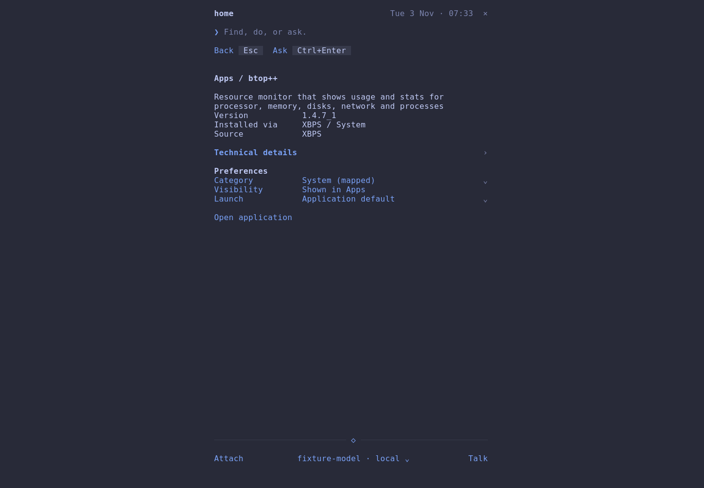
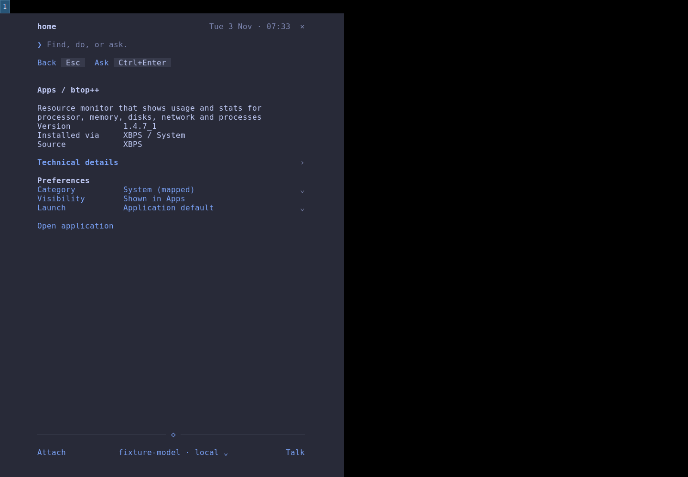
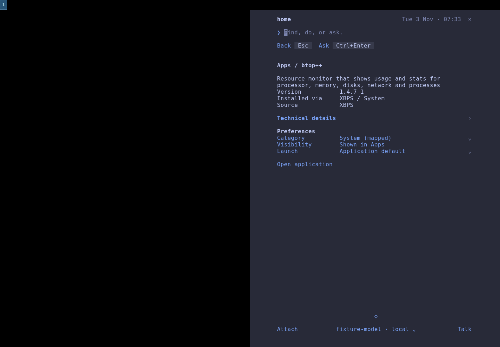

# Apps v0 native review

The PR body records the final head commit and hosted CI run. `native.json` records
the tested release binary, native environment, viewport geometry and observed
interaction checks. `source-sha256.json` records the native checkout's sources,
compared with the submitted files. The release binary is pinned in `dialog/dialog.env`.

The eight primary captures use real Void Linux desktop entries and on-demand
XBPS metadata, with one theme, monospace font at 12 points and scale 1. The
headless Sway output is 1440x1000; its bar reserves 28 pixels. Model and voice
availability are fixtures; no inference or external account is needed for Apps.
All preferences and added test entries belong to a temporary HOME.

| Surface | Compact | Fullscreen | Left snap | Right snap |
| --- | --- | --- | --- | --- |
| Apps |  |  |  |  |
| Details |  |  |  |  |

## Visual review, separate from automated checks

1. **Browse and search: pass.** The grouped list keeps compact type and row
   spacing. Fullscreen centers the entire shared column. Equal 720x972 snap
   regions have the same internal geometry and sit at y=28. Active search and
   selection survive the complete mode cycle; the Details keycap opens the
   selected app through the configurable key action.
2. **Inspect: pass.** The overview, single Technical details disclosure and
   Preferences group have aligned values and chevrons. Display names are
   lowercase; identifiers and copied paths retain their spelling. Reopening
   Details refreshes package and running-window information. The local fixture
   in [missing metadata](missing-metadata.png) has no package ownership, which is
   shown as Unavailable rather than a guessed version or policy.
3. **Organize and edit: pass.** Category creation, rename, mapping edits, confirmed
   deletion, per-app overrides and hide/restore were exercised through native
   controls. Preferences survive restart. Expanded content and unsaved edits
   survive all four modes. Wrapped preference values share their label's focus
   and click target.
4. **Minimum size: pass at 36x20.** [Long metadata](minimum-long-metadata.png),
   [clipboard completion](minimum-technical-attachment.png) and
   [preferences](minimum-preferences-attachment.png) show the populated footer
   with a long attachment. Values reflow; Page Up/Down and the wheel can reach
   every metadata line. The divider, blank row, controls and bottom inset remain
   reserved. Remove activates its visible target after resizing. A shortened
   model label opens the selector, where its full identity is available.
5. **Launch and recover: pass.** Installed foot and Terminal=true btop launch
   through GIO. Enter and click use the same saved preference. Two btop windows
   establish MRU focus behavior; removing both verifies the launch-if-none path.
   A labelled desktop-entry fixture exercises a declared New window action using
   real foot windows. Home clears from view after confirmed focus and returns
   through Super+Space; [the opened application](application-opened.png) is visible
   without home covering it. [No matches](no-matches.png), [hidden search](hidden-search.png),
   [empty catalog](empty-catalog.png), [discovery failure](discovery-failure.png)
   and [launch failure](launch-failure.png) keep readable feedback and recovery.
   Empty/discovery/launch failure screenshots deliberately use adapter response
   fixtures; native adapter tests separately exercise real unavailable entries.

The review caught and corrected an input-reader deadlock during resize, a hidden
Details shortcut, a clipboard completion timeout, clipped selected preference
values and metadata that could not be reached while keyboard focus stayed on an
action. The shared frame handles repainting and wrapped control hit targets.
The native resize stress exercise repeated eight complete mode cycles with
pointer interaction; the PTY regression checks repeated resizes without input
and rejects cursor-position queries during those resizes.

## Reproduce

Local validation: 278 Rust tests passed, including 11 Apps regressions. The native
workflow passed all 12 checks recorded in `native.json`. Seven adapter tests
passed on Void; macOS runs three portable cases and explicitly skips four GIO
cases. Two clean musl release builds produced the same SHA-256:
`426682f9eada930c59696561bba301557d010e1b2fb665ec94f1d00ece13ed87`.
The PR records the complete push-gate result and hosted CI result for its head.

```sh
cd dialog
cargo fmt --check
cargo clippy --locked --all-targets -- -D warnings
cargo test --locked
cd ..
python3 tests/apps_test.py
sh tests/gate.sh --quick
```

On Void with Sway, foot, grim, wtype and wl-clipboard available:

```sh
sh tests/dialog_build.sh
python3 tests/apps_desktop_proof.py \
  dialog/target/x86_64-unknown-linux-musl/release/spark-dialog /tmp/apps-proof
```

The native script performs the flows above, records observed checks, compares
left/right terminal composition, copies the original launcher path, and restarts
home to read persisted preferences. It leaves the user's actual desktop and
launcher preferences untouched. `tests/apps_test.py` uses isolated desktop-entry
fixtures for precedence, hidden entries, unavailable executables, field-code
expansion, declared actions and inert metadata inspection. Those GIO cases run
on Linux and explicitly skip on macOS.

## Limits

Native validation covers Sway/Wayland on Void. X11 class matching, DBus-activated
applications, Flatpak permissions and other package managers were not exercised
interactively. Sway exposes focus order within groups rather than global focus
timestamps; ambiguous matching windows in separate groups produce a diagnostic
instead of an arbitrary focus choice. New window is offered only for a declared
New window action. An accepted launch without an observed window remains a
request, not a claimed success.

Keyboard navigation, visible focus, pointer targets, reflow and the supplied
palette were reviewed. Screen-reader behavior and formal accessibility
conformance were not assessed. Screenshots establish appearance; the native
interaction checks and tests establish behavior.
